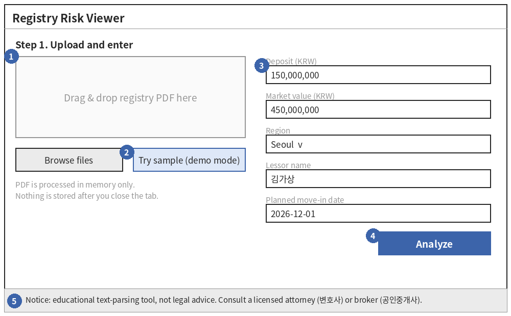
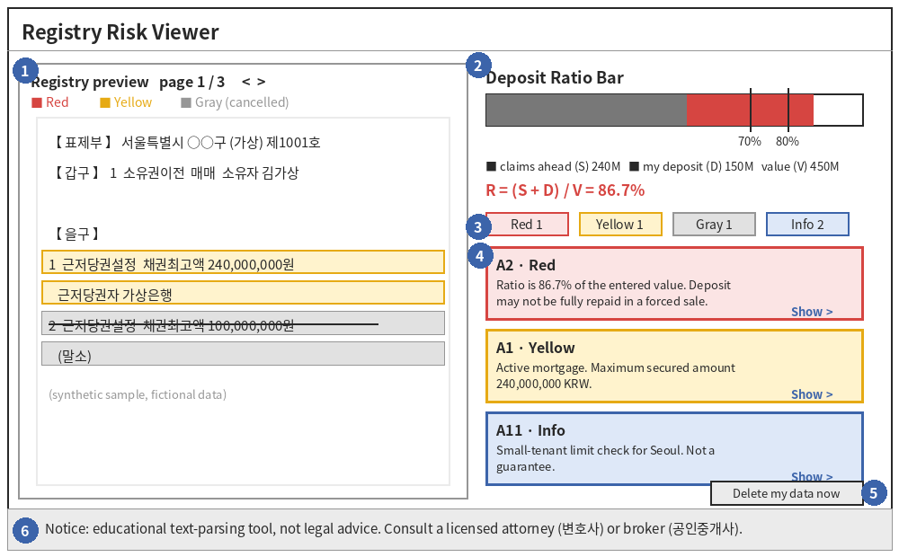
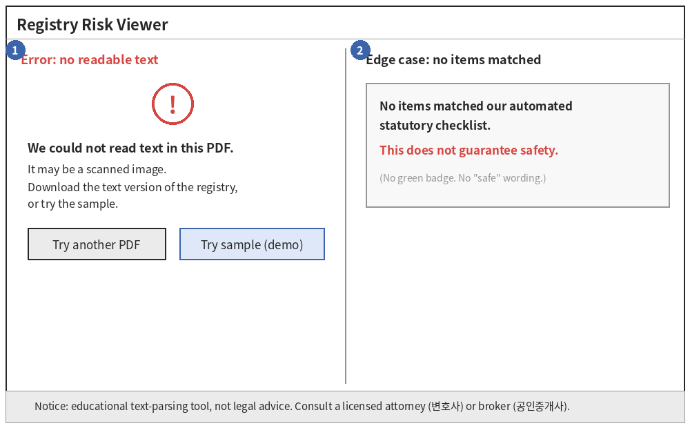

> **Notice:** This service is an educational text-parsing tool and does not constitute legal advice or formal document review. Always consult a licensed attorney (변호사) or certified real estate broker (공인중개사) before signing contracts.

**Design Specification v1.0** (Final Term Project, due 2026-11-16). All sample data is synthetic. Wireframes are AI-generated. Development log: [`report/00_intro.md`](report/00_intro.md)

---

# Registry Risk Viewer

Design Specification (Final Term Project)

| **Item**       | **Detail**                                                                                                                                           |
|----------------|------------------------------------------------------------------------------------------------------------------------------------------------------|
| Title          | Registry Risk Viewer: a registry-reading and risk-checklist assistant for first-time renters (Legal-Tech)                                            |
| Author / Track | Legal Studies & Legal-Tech Track                                                                                                                     |
| Version / Date | v1.0, November 9, 2026 (submission due November 16, 2026)                                                                                            |
| Open tools     | GitHub, Streamlit Community Cloud, Python, PyMuPDF; optional Claude API or an open-source model                                                      |
| Note           | All sample data in this document is synthetic (fictional names, addresses and amounts). Wireframes were generated with AI assistance (AI-generated). |

## 1. The Idea

Registry Risk Viewer is a free web app that helps first-time renters (university students and young adults) read a Korean property registry (등기사항전부증명서). The user uploads the registry PDF and types the planned deposit and the property's market value. The app marks the entries that matter (mortgages, seizures, provisional registrations, trusts) directly on the document in color, compares the claims ahead of the tenant with the property value, and explains each flag in plain language with the statute it rests on. It matters because the deposit is often a young renter's largest sum of money, the registry is 4 to 8 pages of dense legal terms, and a missed entry can mean losing the deposit in a forced sale. The app is an educational checklist, not a verdict: all risk logic runs in auditable Python rules (the AI model never decides risk), it never says a contract is "safe", and it keeps no user data.

## 2. A Concrete Example

### 2.1 Input

A user uploads the registry below (synthetic sample) and types the deposit, market value, region, lessor name and planned move-in date.

| **Source** | **Entry**                     | **Key content**                                                                                | **Status**                 |
|------------|-------------------------------|------------------------------------------------------------------------------------------------|----------------------------|
| 갑구 no. 1 | 소유권이전 (매매), 2021-05-10 | Owner: 김가상 (fictional)                                                                      | ACTIVE                     |
| 을구 no. 1 | 근저당권설정, 2024-03-15      | Maximum secured amount 240,000,000 KRW; mortgagee 가상은행                                     | ACTIVE                     |
| 을구 no. 2 | 근저당권설정, 2019-02-01      | Maximum secured amount 100,000,000 KRW                                                         | CANCELLED (strike-through) |
| User input | Deposit D = 150,000,000 KRW   | Market value V = 450,000,000 KRW; region Seoul; lessor name 김가상; planned move-in 2026-12-01 |                            |

### 2.2 Output the user sees

Calculation by the rule engine: S = 240,000,000 (only the active mortgage counts; the cancelled entry is excluded). R = (S + D) / V = (240,000,000 + 150,000,000) / 450,000,000 = 0.867, which is 86.7% and at or above 0.80, so rule A2 shows Red.

| **Card**         | **Severity**     | **Text shown to the user (shortened)**                                                                                                                                                                                                                                                                          |
|------------------|------------------|-----------------------------------------------------------------------------------------------------------------------------------------------------------------------------------------------------------------------------------------------------------------------------------------------------------------|
| A2 Ratio         | Red (High Risk)  | The claims ahead of you plus your deposit equal 86.7% of the market value you entered. If the property is sold at auction for less than expected, your deposit may not be fully repaid. Please check the value (recent sales or an appraisal). \[Housing Lease Protection Act Art. 3-2(2); Civil Act Art. 357\] |
| A1 Mortgage      | Yellow (Caution) | An active mortgage (근저당권) is registered. The maximum secured amount is 240,000,000 KRW, which is often about 120% to 130% of the actual loan. Ask the lender for the current balance. \[Civil Act Art. 357\]                                                                                                |
| Cancelled entry  | Gray (Info)      | Entry no. 2 was cancelled (말소). It is shown for information and is not counted in S.                                                                                                                                                                                                                          |
| A11 Small tenant | Info (No color)  | On the reference date (2024-03-15), your deposit of 150,000,000 KRW is within the Seoul limit of 165,000,000 KRW. A priority repayment of up to 55,000,000 KRW may apply, limited by the sale proceeds. This does not guarantee recovery. \[Housing Lease Protection Act Art. 8\]                               |
| A12 Checklist    | Info (No color)  | Move-in report (전입신고), fixed date (확정일자), keeping occupancy, and the demand for distribution (배당요구).                                                                                                                                                                                                |
| D1 Lessor check  | (not triggered)  | The lessor name matches the registered owner, so no flag is shown.                                                                                                                                                                                                                                              |

*Every result screen also shows: "Notice: This service is an educational text-parsing tool and does not constitute legal advice or formal document review. Always consult a licensed attorney (변호사) or certified real estate broker (공인중개사) before signing contracts."*

## 3. Screen Design

Three screens: (1) upload and input, (2) results, (3) error and edge-case states. Wireframes are AI-generated.

### Screen 1: Upload and input

*Figure 1. Upload and input screen (AI-generated wireframe, synthetic data)*

| **\#** | **Element**            | **What it does**                                                                                                                |
|--------|------------------------|---------------------------------------------------------------------------------------------------------------------------------|
| 1      | PDF drop zone          | Accepts the registry PDF. The file is read in memory only.                                                                      |
| 2      | Try sample (demo mode) | Loads a synthetic registry so the app works without any upload or API key.                                                      |
| 3      | Input fields           | Deposit, market value, region, lessor name and planned move-in date. They feed rules A2, A11, D1 and the Opposition Power date. |
| 4      | Analyze button         | Runs parsing and the rule engine, then opens Screen 2.                                                                          |
| 5      | Disclaimer bar         | Always visible. Fixed legal notice (Attorney-at-Law Act Art. 109).                                                              |

### Screen 2: Results (dual pane)

*Figure 2. Results screen (AI-generated wireframe, synthetic data)*

| **\#** | **Element**                  | **What it does**                                                                                                                                                       |
|--------|------------------------------|------------------------------------------------------------------------------------------------------------------------------------------------------------------------|
| 1      | Registry preview (left pane) | Shows the PDF page with color highlights: Red = high risk, Yellow = caution, Gray = cancelled or informational. Strike-through lines are shown in gray.                |
| 2      | Deposit Ratio Bar            | Shows S (claims ahead) and D (your deposit) against the entered value V, with marks at 70% and 80%. It shows the ratio only and carries no safety score or green zone. |
| 3      | Filter chips                 | Show or hide cards by Red, Yellow, Gray and Info.                                                                                                                      |
| 4      | Explanation cards            | Plain-language text plus the statute reference. The "Show" link scrolls the left pane to the matching line.                                                            |
| 5      | Delete my data now           | Clears all session data immediately.                                                                                                                                   |
| 6      | Disclaimer bar               | Always visible.                                                                                                                                                        |

### Screen 3: Error and edge case

*Figure 3. Error state (left) and no-match state (right) (AI-generated wireframe)*

| **\#** | **Element**            | **What it does**                                                                                         |
|--------|------------------------|----------------------------------------------------------------------------------------------------------|
| 1      | Unreadable PDF message | Shown when the PDF has no text layer (for example a scanned image). Offers another upload or the sample. |
| 2      | No-match message       | Shown when no rule matches. It never uses green or the word "safe".                                      |

## 4. User Flow

1.  The user opens the app and sees the educational notice.

2.  The user uploads a registry PDF, or clicks "Try sample".

3.  The app checks the file: it must be a PDF with a text layer and contain the section titles 표제부, 갑구 and 을구.

4.  The user types deposit, market value, region, lessor name and planned move-in date.

5.  The user clicks "Analyze". The app splits the document, detects cancelled (struck-through) lines, finds the reference date (말소기준권리) and runs rules A to D.

6.  The app shows Screen 2: highlights on the document, the Deposit Ratio Bar and explanation cards.

7.  The user clicks a card. The left pane jumps to the highlighted line.

8.  Optional: the user asks the glossary helper what a term means (AI, or a saved answer in demo mode).

9.  The user clicks "Delete my data now" or closes the tab. All session data is gone.

| **Case**  | **Trigger**                                            | **What the app does**                                                                                                 |
|-----------|--------------------------------------------------------|-----------------------------------------------------------------------------------------------------------------------|
| Error     | The PDF is a scanned image (no text) or not a registry | Shows Screen 3 (left). Does not guess. Offers another PDF, the sample, or the text version from the registry service. |
| Edge case | The text is readable but no rule matches               | Shows: "No items matched our automated statutory checklist. This does not guarantee safety."                          |
| Edge case | The app cannot tell if a line is struck through        | Asks the user to confirm whether that entry is cancelled before counting it in S.                                     |

## 5. Data

| **Data**                    | **Source**                                                   | **How collected**                                           | **License / terms**                                                                                            | **Status**                                 |
|-----------------------------|--------------------------------------------------------------|-------------------------------------------------------------|----------------------------------------------------------------------------------------------------------------|--------------------------------------------|
| Registry PDF (user's own)   | Issued by the online registry service (인터넷등기소)         | The user uploads it. Processed in memory only; never stored | The service overview page states fees and legal effect but no reuse conditions; no separate terms of use found | \[Reported\]                               |
| Synthetic sample registries | Written by the author (fictional people, addresses, amounts) | Hand-made PDFs and JSON                                     | Released with the repository under its open-source license (to be chosen)                                      | Own work                                   |
| Statutes and decrees        | National Law Information Center (law.go.kr)                  | Read by the author; encoded as rules and card text          | Statutes are generally not protected by copyright; the exact provision to be confirmed                         | \[Reported\]                               |
| Small-tenant amount tables  | Decree text; cross-checked with secondary articles           | Typed into a lookup table with effective dates              | Same as statutes                                                                                               | \[Reported\] (Seoul rows); others to check |
| User inputs                 | The user                                                     | Typed into the form                                         | Held in session memory only                                                                                    | n/a                                        |

*No scraping and no registry API is used. The app never downloads registries by itself.*

## 6. AI and Prompts

Model: Claude Haiku 5.5 (claude-haiku-5-5) through the Anthropic API, an optional feature. The model name is a configuration value (ANTHROPIC_MODEL) so it can be changed, and a small, low-cost model is enough for these two short tasks. Open-source fallback: an instruction-tuned model on Hugging Face, to be chosen after testing its Korean quality. The AI has two narrow jobs: (a) turn one messy registry entry into structured fields when the regular-expression parser fails, and (b) explain a registry term in plain Korean. The AI never decides risk, never calculates the ratio, and never says whether a contract is safe. Only the text of one entry or one term is sent, with personal names masked.

**Prompt 1: Entry normalization (output must be JSON only)**

System: "You convert ONE entry of a Korean property registry (등기사항전부증명서) into JSON. Output only JSON that matches this schema: {section, rank_no, receipt_date, purpose, cause, holder, amount, status}. Use null for any field that is not in the text. Do not judge risk and do not add explanations." User: "\<entry text\>"

**Prompt 2: Plain-language glossary**

System: "You explain Korean property-registry terms to a first-time renter in plain Korean, in at most 3 short sentences. Do not say whether a contract or a house is safe or unsafe. Do not give legal advice. End with: '정확한 판단은 변호사 또는 공인중개사와 상담하세요.'" User: "What does \<term\> mean?"

Guardrail (code, not AI): every AI answer is scanned for forbidden wording such as "safe", "안전" and "문제없음". An answer that contains it is replaced by the saved glossary text. In demo mode there are no API calls: saved JSON answers and pre-parsed samples are used.

## 7. System Structure

| **Part**                  | **Tool**                                                     | **Role**                                                            |
|---------------------------|--------------------------------------------------------------|---------------------------------------------------------------------|
| Browser UI                | Streamlit (split screen: page image with highlights + cards) | Upload, inputs, results, delete button                              |
| Hosting                   | Streamlit Community Cloud                                    | Runs the Python app from the GitHub repository                      |
| PDF reading               | PyMuPDF (fitz), in memory via io.BytesIO                     | Text, page images and word bounding boxes; strike-through detection |
| Segmentation and parser   | Python                                                       | 표제부 / 갑구 / 을구 split; entry normalization                     |
| Rule engine               | Python functions (Appendix A)                                | All risk logic, auditable                                           |
| Card and glossary library | Local JSON/YAML files                                        | Plain-language texts and statute references                         |
| AI (optional)             | Claude API or a Hugging Face open model                      | Prompts 1 and 2 only                                                |
| Code and checks           | GitHub, GitHub Actions, Pytest                               | Version control and automatic tests                                 |
| Prototyping               | Google Colab or Codespaces                                   | Trying the parser on synthetic samples                              |

Data flow: PDF and inputs → memory buffer → segmentation → entry parser → rule engine → cards and highlights → screen. Nothing is written to disk or a database.

## 8. Risks and Limits

| **Risk**                                                             | **Why it matters**                     | **How the design handles it**                                                                                  |
|----------------------------------------------------------------------|----------------------------------------|----------------------------------------------------------------------------------------------------------------|
| Misreading the PDF (for example a cancelled entry counted as active) | Wrong S gives a wrong ratio            | Cancelled-line detector plus a user confirmation prompt when unsure. Strike-through parsing is \[Unverified\]. |
| Users read "no flags" as "safe"                                      | Dangerous over-trust                   | Fixed wording: "This does not guarantee safety." No green, no score, no "low risk".                            |
| Outdated legal tables (small-tenant amounts)                         | Wrong ceiling shown                    | Tables stored with effective dates and chosen by the reference date; unknown dates show no number.             |
| Unauthorized practice of law                                         | Attorney-at-Law Act Art. 109           | Educational tool only, free of charge, no advertising, no lawyer referral, permanent disclaimer.               |
| Privacy leak                                                         | Registries contain names and addresses | No database, in-memory processing, delete button, sanitized logs, real PDFs excluded from Git.                 |
| AI hallucination                                                     | Wrong explanation                      | AI limited to two narrow tasks, JSON schema, forbidden-word guardrail, fallback to saved texts.                |
| Wrong market value typed by the user                                 | Wrong ratio                            | The entered value is always shown beside the ratio; the app never estimates prices.                            |

**What the app will NOT do**

- It will not say a contract or house is safe or unsafe, and it will not give legal advice or review a contract.

- It will not estimate the property's price.

- It will not check what a registry does not contain: unpaid taxes of the owner, other tenants' fixed dates and deposits, or the building ledger (건축물대장).

- It will not read scanned images or registries in formats it was not built for.

- It will not store, sell or share any user data.

## 9. Cost Plan

The idea works with a total required cost of 0 KRW. The paid API is optional.

| **Item**                            | **Tool**                                           | **Cost**                                                   | **Note**                                                                                                                                   |
|-------------------------------------|----------------------------------------------------|------------------------------------------------------------|--------------------------------------------------------------------------------------------------------------------------------------------|
| Hosting                             | Streamlit Community Cloud                          | Free                                                       | Public GitHub repository required                                                                                                          |
| Code, versioning, tests             | GitHub and GitHub Actions                          | Free                                                       | Free tier for public repositories                                                                                                          |
| PDF reading                         | PyMuPDF                                            | Free                                                       | Its license (AGPL) must be compatible with the repository license. \[Unverified\] to check                                                 |
| Rule engine and cards               | Python and local JSON                              | Free                                                       | No API needed                                                                                                                              |
| AI features                         | Claude API (optional) or a free Hugging Face model | 0 in demo mode                                             | Without a key the app uses saved samples and saved glossary answers. With a key, a small model and a per-session call limit keep cost low. |
| Registry issuance (user's own cost) | Online registry service                            | 1,000 KRW per internet-issued copy (per its overview page) | Paid by the user to the service, not to this app                                                                                           |
| Prototype screens                   | Streamlit locally or in Codespaces                 | Free                                                       | Used only to test the idea and capture screens                                                                                             |

## Appendix A. Deterministic Rule Engine

### A.1 Pre-processing and formulas

1.  Normalization: Entry(id, section, rank_no, receipt_date, purpose, cause, holder, amount, status: ACTIVE \| CANCELLED, bboxes).

2.  Extinguishment pivot (말소기준권리): the earliest receipt_date among active 근저당권, 압류, 가압류 and 경매개시결정 (Civil Execution Act Art. 91(2)). Called Date_Pivot.

3.  Opposition Power (대항력) date: planned move-in report date + 1 day at 00:00 KST (Housing Lease Protection Act Art. 3(1)).

4.  Senior claims S = sum of active maximum secured amounts + sum of senior lease deposits (선순위 전세금 / 임차권등기).

5.  Deposit ratio R = (S + D) / V, where D = the user's deposit and V = the user-entered market value.

### A.2 Group A: Civil Act, Civil Execution Act, Housing Lease Protection Act

| **ID** | **Trigger Condition**                       | **Legal Basis**                                                            | **Severity**                                           | **Formula / Calculation**                                                                                                                   | **Action & Output**                                                                                                                                                                                                      |
|--------|---------------------------------------------|----------------------------------------------------------------------------|--------------------------------------------------------|---------------------------------------------------------------------------------------------------------------------------------------------|--------------------------------------------------------------------------------------------------------------------------------------------------------------------------------------------------------------------------|
| A1     | Active 근저당권설정 in Eul-gu               | Civil Act Art. 357, 186; Civil Execution Act Art. 91(2)                    | Yellow (Caution)                                       | Extract 채권최고액 (maximum secured amount) and add to senior claims S.                                                                     | Card explains that 채권최고액 is typically about 120%–130% of the actual loan. Prompts confirmation with the lender.                                                                                                     |
| A2     | Risk ratio R ≥ 0.70                         | Housing Lease Protection Act Art. 3-2(2); Civil Act Art. 357               | Yellow (0.70 ≤ R \< 0.80) / Red (R ≥ 0.80)             | R = (S + D) / V. Yellow if 0.70 ≤ R \< 0.80; Red if R ≥ 0.80.                                                                               | Deposit Ratio Bar fills dynamically. Red flag warns of potential deposit loss in foreclosure.                                                                                                                            |
| A3     | Active 경매개시결정 in Gap-gu               | Civil Execution Act Art. 83(1), 91; Housing Lease Protection Act Art. 8(1) | Red (High Risk)                                        | Boolean: purpose contains 경매개시결정.                                                                                                     | Immediate high-risk alert. Explains that leases made after the auction registration lose priority repayment rights.                                                                                                      |
| A4     | Active 압류 or 체납처분압류 in Gap-gu       | Civil Execution Act Art. 83, 91(3); National Tax Collection Act Art. 24    | Red (High Risk)                                        | Boolean: purpose contains 압류 or tax-office seizure.                                                                                       | Warns that a government body or creditor has an enforcement lock; a public auction may follow.                                                                                                                           |
| A5     | Active 가압류 in Gap-gu                     | Civil Execution Act Art. 276, 91(3)                                        | Red (High Risk)                                        | Boolean: purpose contains 가압류.                                                                                                           | Highlights a monetary-claim freeze prior to forced sale.                                                                                                                                                                 |
| A6     | Active 가처분 (e.g., 처분금지) in Gap-gu    | Civil Execution Act Art. 300                                               | Red (High Risk)                                        | Boolean: purpose contains 가처분.                                                                                                           | Warns of a pending ownership or disposition dispute.                                                                                                                                                                     |
| A7     | Active 전세권설정 preceding lease date      | Civil Act Art. 303; Civil Execution Act Art. 91(4)                         | Yellow (Red if R ≥ 0.80)                               | Check receipt_date \< Lease Date. Add 보증금 to S.                                                                                          | Senior leasehold claim; paid before the user in auction unless waived.                                                                                                                                                   |
| A8     | Active 지상권 or 지역권                     | Civil Act Art. 279, 291; Civil Execution Act Art. 91(3)                    | Yellow (Caution)                                       | Boolean check. Flag as informational if a mortgage exists (담보지상권).                                                                     | Land-use restrictions that survive auction.                                                                                                                                                                              |
| A9     | Active 환매특약 in Gap-gu                   | Civil Act Art. 590, 591, 592                                               | Red (High Risk), if within the 5-year statutory period | Check registration date + 5 years against the current date.                                                                                 | If the seller properly exercises the repurchase right within the period, limited real rights such as mortgages registered after the repurchase registration are extinguished (Civil Act Art. 592; case: see Appendix B). |
| A10    | Active 임차권등기명령 in Eul-gu             | Housing Lease Protection Act Art. 3-3                                      | Red (High Risk)                                        | Boolean trigger. Add registered amount to S.                                                                                                | Flags that a prior tenant was not refunded their deposit upon moving out.                                                                                                                                                |
| A11    | Small-Tenant Eligibility Check (소액임차인) | Housing Lease Protection Act Art. 8; Enforcement Decree Art. 10, 11        | Informational (No Color)                               | Select the table row by Date_Pivot (the extinguishment pivot date, 2.1 step 2), NOT the lease date. Check D ≤ deposit limit for the region. | Displays the maximum priority repayment amount (최우선변제금). Does not guarantee recovery. See lookup tables below.                                                                                                     |
| A12    | Timing & Compliance Checklist               | Housing Lease Protection Act Art. 3, 3-2                                   | Informational (No Color)                               | Always rendered in summary view.                                                                                                            | Checklist for 전입신고, 확정일자, occupancy maintenance, and demand for distribution (배당요구).                                                                                                                         |

**Lookup tables for rule A11 (choose by Date_Pivot, not by lease date)**

**Table A11-1: Date_Pivot on or after 2023-02-21**

| **Region**                                                                                 | **Deposit limit (D ≤)** | **Priority repayment cap** |
|--------------------------------------------------------------------------------------------|-------------------------|----------------------------|
| Seoul Special City                                                                         | 165,000,000 KRW         | 55,000,000 KRW             |
| Overcrowded Control Region (excl. Seoul) / Sejong / Yongin / Hwaseong / Gimpo              | 145,000,000 KRW         | 48,000,000 KRW             |
| Metropolitan Cities (excl. Overcrowded), plus Ansan / Gwangju / Paju / Icheon / Pyeongtaek | 85,000,000 KRW          | 28,000,000 KRW             |
| Other regions                                                                              | 75,000,000 KRW          | 25,000,000 KRW             |

**Table A11-2: Date_Pivot from 2021-05-11 to 2023-02-20**

| **Region**                                                                                         | **Deposit limit (D ≤)** | **Priority repayment cap** |
|----------------------------------------------------------------------------------------------------|-------------------------|----------------------------|
| Seoul Special City                                                                                 | 150,000,000 KRW         | 50,000,000 KRW             |
| Overcrowded Control Region (excl. Seoul) / Sejong / Yongin / Hwaseong                              | 130,000,000 KRW         | 43,000,000 KRW             |
| Metropolitan Cities (excl. Overcrowded), plus Ansan / Gwangju / Paju / Icheon / Pyeongtaek / Gimpo | 70,000,000 KRW          | 23,000,000 KRW             |
| Other regions                                                                                      | 60,000,000 KRW          | 20,000,000 KRW             |

*If Date_Pivot is earlier than 2021-05-11 or unknown, no number is shown. The cap is also limited to one half of the sale proceeds of the house (Housing Lease Protection Act Art. 8(3)). Seoul rows were cross-checked with secondary 2026 articles; other rows need a check against the decree text.*

### A.3 Group B: Act on Ownership and Management of Buildings

| **ID** | **Trigger Condition**                                                  | **Legal Basis**                                                                          | **Severity**                                                               | **Logic & Handling**                                                                                                                                                                                    |
|--------|------------------------------------------------------------------------|------------------------------------------------------------------------------------------|----------------------------------------------------------------------------|---------------------------------------------------------------------------------------------------------------------------------------------------------------------------------------------------------|
| B1     | Pyojebeu shows no Land Right (대지권 미등기) for a multi-unit property | Act on Ownership & Management of Buildings Art. 20; Real Estate Registration Act Art. 61 | Yellow (Caution)                                                           | Parse Pyojebeu. Trigger if property type is 집합건물 and 대지권의 표시 is missing or unrecorded.                                                                                                        |
| B2     | Pyojebeu contains a note on separate land registration (토지별도등기)  | Act on Ownership & Management of Buildings Art. 20 (related case law: see Appendix B)    | Yellow (prompt to upload land registry) / Red (if land encumbrances exist) | Scan the land-right section (대지권의 표시란) of the unit's Pyojebeu. Remove all spaces, then match the phrase variants '토지별도등기있음' and '토지등기부에별도의등기있음' (pattern: 별도의?등기있음). |
| B3     | Joint collateral (공동담보) listed across multiple units               | Act on Ownership & Management of Buildings Art. 21; Civil Act Art. 368                   | Yellow (Caution)                                                           | Scan Eul-gu for 공동담보 references.                                                                                                                                                                    |

### A.4 Group C: Act on Security by Provisional Registration

| **ID** | **Trigger Condition**                                     | **Legal Basis**                                              | **Severity**    | **Logic & Handling**                                                                          |
|--------|-----------------------------------------------------------|--------------------------------------------------------------|-----------------|-----------------------------------------------------------------------------------------------|
| C1     | Active 소유권이전청구권가등기 in Gap-gu                   | Real Estate Registration Act Art. 88, 91, 92                 | Red (High Risk) | Parse Gap-gu for an active 가등기.                                                            |
| C2     | Provisional registration treated as security (담보가등기) | Act on Security by Provisional Registration Art. 2, 3, 4, 12 | Red (High Risk) | Evaluated alongside C1. Treat as mortgage-equivalent with settlement restrictions (청산기간). |
| C3     | Cause contains 매매예약 or 대물변제예약                   | Act on Security by Provisional Registration Art. 1, 2        | Red (High Risk) | Keyword matching in registration cause (등기원인).                                            |

### A.5 Group D: Act on Real Estate Real-Name Registration

| **ID** | **Trigger Condition**                                                                     | **Legal Basis**                                           | **Severity**             | **Logic & Handling**                                                                              |
|--------|-------------------------------------------------------------------------------------------|-----------------------------------------------------------|--------------------------|---------------------------------------------------------------------------------------------------|
| D1     | Lessor name input differs from Gap-gu current owner, or lessor is an agent                | Civil Act Art. 186, 114; Real-Name Act Art. 3, 4          | Red (High Risk)          | Compare UserInputs.lessor_name with Gap-gu.current_owner_name.                                    |
| D2     | User indicates the lessor claims to be the 'Real Owner' while registered under a relative | Real Estate Real-Name Registration Act Art. 3(1), 4(1)    | Red (High Risk)          | Input toggle check on lessor relationship.                                                        |
| D3     | Indirect indicators: recent title transfer + non-resident address                         | Real Estate Real-Name Registration Act Art. 3(1)          | Yellow (Question Prompt) | Flag if title transfer occurred within 12 months AND owner address differs from property address. |
| D4     | Registered trust (신탁등기) in Gap-gu                                                     | Trust Act Art. 2, 4; Real Estate Registration Act Art. 81 | Red (High Risk)          | Parse Gap-gu for 신탁.                                                                            |

## Appendix B. Verification Labels

| **Label**      | **Item**                                                                                                                                                                                                         | **Status / Basis**                                                                                                                                                                                                                                                        |
|----------------|------------------------------------------------------------------------------------------------------------------------------------------------------------------------------------------------------------------|---------------------------------------------------------------------------------------------------------------------------------------------------------------------------------------------------------------------------------------------------------------------------|
| \[Verified\]   | PyMuPDF bbox extraction                                                                                                                                                                                          | Verified via local Python execution.                                                                                                                                                                                                                                      |
| \[Verified\]   | Streamlit session memory and 12-hour container reset                                                                                                                                                             | Verified via Streamlit documentation.                                                                                                                                                                                                                                     |
| \[Verified\]   | Attorney-at-Law Act Art. 109                                                                                                                                                                                     | Verified via statute text and legal news summaries.                                                                                                                                                                                                                       |
| \[Reported\]   | A11 Seoul rows (165M / 55M since 2023-02-21; 150M / 50M before)                                                                                                                                                  | Consistent across several secondary 2026 articles. Decree text still to be checked.                                                                                                                                                                                       |
| \[Reported\]   | A11 non-Seoul rows and regional group definitions                                                                                                                                                                | Secondary summaries only.                                                                                                                                                                                                                                                 |
| \[Reported\]   | HUG guarantee limits (90% valuation rule)                                                                                                                                                                        | Secondary real-estate guides.                                                                                                                                                                                                                                             |
| \[Reported\]   | Statutes are generally not protected by copyright                                                                                                                                                                | General knowledge; exact provision to confirm.                                                                                                                                                                                                                            |
| \[Reported\]   | Online registry service overview page                                                                                                                                                                            | Describes fees (internet view 700 KRW, internet issue 1,000 KRW) and says an internet-issued certificate has the same legal effect as one issued at the registry office. It states no conditions on reuse, and no separate terms of use were found.                       |
| \[Unverified\] | PyMuPDF license (AGPL) compatibility with the repository license                                                                                                                                                 | To check.                                                                                                                                                                                                                                                                 |
| \[Reported\]   | 대법원 2002-09-27, 2000다27411 (cited for A9)                                                                                                                                                                    | Case exists. Summary: after a repurchase registration, if the seller exercises the right within the period, later mortgages and other limited real rights are extinguished. Full text to be read on law.go.kr to upgrade to \[Verified\].                                 |
| \[Reported\]   | 대법원 2026-08-13, 2025다218240 and 218241 (related to B2)                                                                                                                                                       | Case exists on the court and law.go.kr sites. Summary: a mortgage set only on the land after the site-use right arose breaches the ban on separate disposal (Act Art. 20). It is related to, but not the same as, the 토지별도등기 note; a more direct case may be added. |
| \[Reported\]   | The note that a separate registration exists on the land is made under a nationwide rule (Real Estate Registration Rules Art. 90; Registry Guideline No. 1470), in the land-right section of the unit's Pyojebeu | Rule text read on a secondary legal-commentary site, so the note does not depend on the region. Read the rule on law.go.kr to upgrade to \[Verified\].                                                                                                                    |
| \[Unverified\] | Exact phrase printed in real registries (variants such as '토지별도등기있음' and '토지등기부에 별도의 등기 있음')                                                                                                | Rule B2 uses space-ignoring pattern matching. To be confirmed with real samples.                                                                                                                                                                                          |
| \[Unverified\] | Strike-through parsing in complex registries                                                                                                                                                                     | Handled by user-confirmation prompts; needs samples.                                                                                                                                                                                                                      |
| \[Unverified\] | Rule logic as a whole                                                                                                                                                                                            | Requires practitioner review before any real use.                                                                                                                                                                                                                         |

## Appendix C. Legal Compliance (Attorney-at-Law Act Art. 109)

1.  No legal consultation or representation: the app is an educational reading assistant and checklist.

2.  Strict non-commerciality: free, no ads, no paid tier, no lawyer referral fees.

3.  No "safe" claims: no green badge, safety score, or phrases such as "Safe contract" or "Low risk". The bar is named Deposit Ratio Bar for this reason. Clean results read: "No items matched our automated statutory checklist. This does not guarantee safety."

4.  Mandatory disclaimer on every analysis view: "Notice: This service is an educational text-parsing tool and does not constitute legal advice or formal document review. Always consult a licensed attorney (변호사) or certified real estate broker (공인중개사) before signing contracts."

## Appendix D. Optional Prototype (not part of the graded design)

A small Streamlit prototype is used only to test the idea and to capture screens for the wireframes. Planned steps: (1) read a synthetic PDF with PyMuPDF and list words with bounding boxes; (2) run rules A1, A2, A11 on the synthetic sample; (3) show the results screen with fixed sample data. Goals such as 15 test PDFs, 90% parsing accuracy and 30 unit tests are future work, not requirements of this design.

## Appendix E. Revision History

| **Version** | **Date**   | **Changes**                                                                                                                                                                                                                                                                                                                    |
|-------------|------------|--------------------------------------------------------------------------------------------------------------------------------------------------------------------------------------------------------------------------------------------------------------------------------------------------------------------------------|
| v0.2        | 2026-11-03 | First full draft: system overview, rule groups A to D, privacy, roadmap.                                                                                                                                                                                                                                                       |
| v0.3        | 2026-11-09 | A2 trigger fixed (R ≥ 0.70). Model name moved to configuration. A11 lookup now selected by Date_Pivot with current and previous tables. Two court-case citations marked \[Unverified\].                                                                                                                                        |
| v1.0        | 2026-11-09 | Restructured into the nine required items. Added a concrete example, three wireframes, a user flow with error and edge cases, a data and license table, prompts, a cost plan and a risk table. "Deposit Safety Bar" renamed "Deposit Ratio Bar" to match the no-safety-claims rule. Roadmap and test plan moved to Appendix D. |

